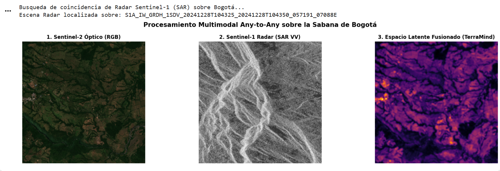
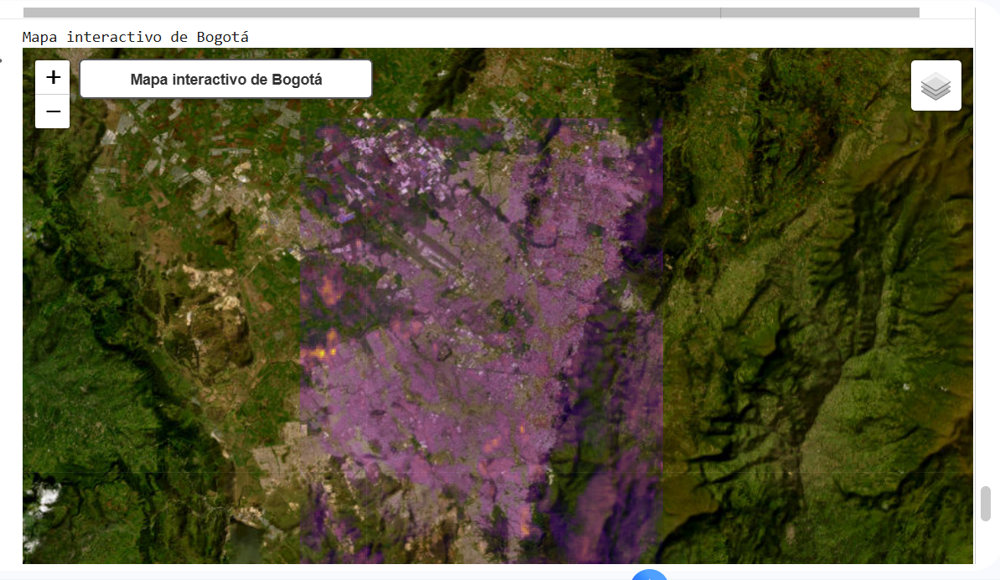
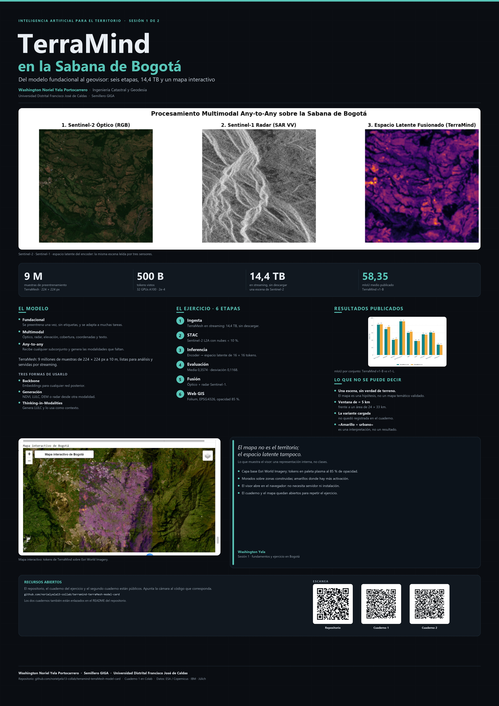

# TerraMind en la Sabana de Bogotá

**Del modelo fundacional multimodal al geovisor: seis etapas, 14,4 TB y un mapa interactivo.**

Sesión 1 de la serie *Inteligencia Artificial para el Territorio* · Semillero GIGA · Universidad Distrital Francisco José de Caldas.

[](https://colab.research.google.com/drive/1bzwfj_2m_CLaQOYhTQE01VfXYe9SjQii?usp=sharing)

---

## Qué es este repositorio

TerraMind es un modelo fundacional multimodal para observación de la Tierra, desarrollado por IBM Research, la ESA Φ-lab y Forschungszentrum Jülich. Se preentrena una vez, sin etiquetas manuales, y se adapta a muchas tareas: cobertura del suelo, agua e inundaciones, quemaduras, cultivos y cambios.

Este cuaderno lleva el modelo a un ejercicio de punta a punta sobre la Sabana de Bogotá: conecta con TerraMesh en streaming, busca una escena de Sentinel-2 en el catálogo STAC, ejecuta el encoder, analiza el espacio latente, lo fusiona con radar Sentinel-1 y publica el resultado en un mapa Folium.

> El mapa es una **hipótesis de trabajo**, no un mapa temático validado. Los límites se explican abajo y en el cuaderno.

## El ejercicio en seis etapas

| # | Etapa | Qué hace |
|---|-------|----------|
| 1 | Ingesta | Conecta a `ibm-esa-geospatial/TerraMesh` en streaming: 14,4 TB sin descargarlos. |
| 2 | STAC | Busca Sentinel-2 L2A sobre Bogotá con menos de 10 % de nubes. |
| 3 | Inferencia | Ejecuta el encoder de TerraMind y obtiene un espacio latente de 16 × 16 tokens. |
| 4 | Evaluación | Mide media, desviación y rango dinámico del tensor latente. |
| 5 | Fusión | Integra una escena Sentinel-1 (SAR, polarización VV). |
| 6 | Web GIS | Publica el resultado en un mapa Folium con `ImageOverlay` en EPSG:4326. |

## Resultados

| Métrica | Valor |
|---------|-------|
| Muestras de preentrenamiento | 9 millones (224 × 224 px, 10 m) |
| Streaming | 14,4 TB |
| Escena Sentinel-2 | `S2A_MSIL2A_20240815T152651_R025_T18NWL_20240815T223702` |
| Espacio latente | 16 × 16 tokens |
| Media del espacio latente | 0,3574 |
| Desviación estándar | 0,1168 |
| Rango dinámico | [0,1386; 1,1823] |
| Escena Sentinel-1 | `S1A_IW_GRDH_1SDV_20241228T104325_20241228T104350_057191_07088E` |
| Ventana analizada | ≈ 5 km (el área de consulta es de 24 × 33 km) |



*Sentinel-2 · Sentinel-1 · espacio latente del encoder: la misma escena leída por tres sensores.*



*Mapa interactivo: tokens de TerraMind sobre Esri World Imagery (EPSG:4326).*

## Lo que no se puede concluir

- **Una sola escena, sin verdad de terreno.** El mapa muestra una representación interna, no clases verificadas.
- **La ventana no cubre el área de consulta.** Se analizaron ≈ 5 km frente a un área de 24 × 33 km.
- **La variante cargada no quedó registrada** en el cuaderno.
- **«Amarillo = urbano» es una interpretación**, no un resultado del modelo.
- El ejercicio sirve para **aprender el flujo y sus límites**, no para tomar decisiones sobre el territorio.

## Cómo ejecutarlo

### En Colab

Abre el cuaderno y ejecuta las celdas en orden. La sesión gratuita con GPU T4 es suficiente:

[Cuaderno en Colab](https://colab.research.google.com/drive/1bzwfj_2m_CLaQOYhTQE01VfXYe9SjQii?usp=sharing)

### En local

```bash
py -m venv .venv
.venv\Scripts\activate        # Windows
pip install -r requirements.txt
jupyter lab notebooks/terramind_bogota.ipynb
```

Se recomienda GPU para la inferencia. El cuaderno fija `numpy<2.0.0` por compatibilidad con `datasets` y TerraTorch.

## Estructura

```
.
├── notebooks/
│   └── terramind_bogota.ipynb   # cuaderno completo, con salidas
├── docs/
│   ├── poster.jpg / poster.pdf  # póster A2 de la sesión
│   ├── figura_multimodal.png
│   └── figura_mapa.png
├── requirements.txt
├── CITATION.cff
└── LICENSE
```

## Póster

[](docs/poster.pdf)

A2 (42 × 59,4 cm), 3508 × 4961 px, 212 ppp. Incluye códigos QR al repositorio y a los dos cuadernos de la serie.

## Datos, modelos y créditos

- **TerraMind** — IBM Research, ESA Φ-lab, Forschungszentrum Jülich. Pesos y código con licencia Apache 2.0.
- **TerraMesh** — conjunto de datos global y multimodal; licencia CC BY-SA 4.0.
- **Sentinel-2 / Sentinel-1** — ESA / Copernicus.
- **Catálogo STAC** — Microsoft Planetary Computer.
- **Documentación del modelo y del dataset** — [terramind-terraMesh-model-card](https://github.com/norielyela13-collab/terramind-terraMesh-model-card).

## Licencia y cita

El código de este repositorio se publica con licencia **MIT** (ver `LICENSE`). Los datos, los pesos y las imágenes de terceros conservan sus licencias originales.

```bibtex
@misc{yela2026terramindbogota,
  author = {Yela Portocarrero, Washington Noriel},
  title  = {TerraMind en la Sabana de Bogotá: del modelo fundacional al geovisor},
  year   = {2026},
  url    = {https://github.com/norielyela13-collab/terramind-bogota-geovisor}
}
```
